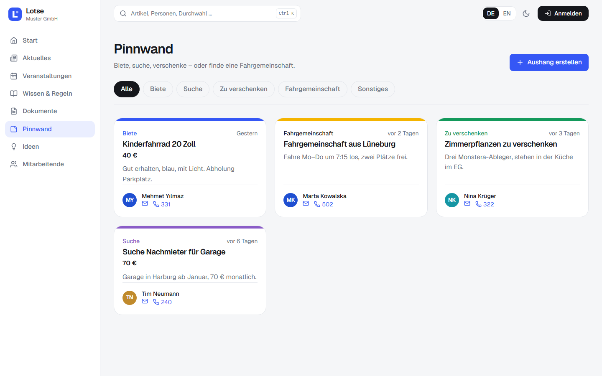

# Lotse – das Intranet für Büro und Lager

Lotse ist ein schlankes Mitarbeiterportal für Firmen mit Büroetagen und Lagerhallen: Neuigkeiten,
Veranstaltungen mit Zusagen, Mitarbeiterverzeichnis mit interaktivem Lageplan, Pinnwand, Ideenbox,
Dokumente und Wissen – zweisprachig (Deutsch/Englisch), mit hellem und dunklem Design.

Lotse braucht keinen Datenbankserver und keinen Webserver davor: **ein einziger Python-Prozess** liefert
API, Uploads und Oberfläche aus. Anmeldung lokal oder über **LDAP/Active Directory (LDAPS/STARTTLS)**.


## Auf einen Blick

| | |
|---|---|
|  |  |
| **Veranstaltungen** – kommende Termine mit „Ich bin dabei“, Kalender und Rückblick | **Kalender** – Monatsansicht, abonnierbar in Outlook |
|  |  |
| **Mitarbeitende** – nach Abteilungen gegliedert, mit E-Mail und Durchwahl | **Lageplan** – interaktiv: Räume, Suche über alle Etagen, Zoom zur Person, Besprechungsräume |
|  |  |
| **Ideenbox** – Verbesserungsvorschläge, Sternebewertung, Status und Antwort | **Pinnwand** – Biete, Suche, Fahrgemeinschaften |
|  |  |
| **Dokumente** – PDFs öffnen sich direkt im Portal | **Fotos** von Veranstaltungen als Galerie |
|  |  |
| **Dunkles Design** – umschaltbar oben rechts | **Verwaltung** – LDAP-Server, Abteilungen, Benutzer, Etagen |
|  |  |
| **Dokumentenbibliothek** – ISO-Dokumente, Richtlinien, Suche | **Anmeldung** – Lesen ohne Login, Anmelden nur zum Schreiben |
|  | |
| **Raum-Editor** – Räume aufziehen, verschieben, Größe ändern; Art, Abteilung, Besprechungsraum-Daten | |

Alle Funktionen im Detail: **[docs/FUNKTIONEN.md](docs/FUNKTIONEN.md)** · Bildnachweise: [docs/CREDITS.md](docs/CREDITS.md)

## Funktionen (Kurzfassung)

- **Startseite** mit großem Slider (z. B. „Weihnachtsfeier 2026“), Neuigkeiten, nächsten Terminen,
  neuen Kolleg:innen, Top-Ideen und den neuesten Aushängen.
- **Aktuelles** und **Wissen & Regeln**: Neuigkeiten, Veranstaltungen, neue Kolleg:innen, neue Produkte,
  Regeln & Richtlinien, Arbeitssicherheit, IT-Sicherheit, Know-how – jeder Artikel auf Deutsch und Englisch.
- **Veranstaltungen**: Demnächst, Kalender, Rückblick; Zusagen mit Teilnehmerliste; `.ics`-Abo für Outlook.
- **Mitarbeitende**: Verzeichnis nach Abteilungen (Einkauf, Verwaltung, Finanzen, IT, Versand, Fulfillment,
  Vertrieb), Suche nach Name, Abteilung, Position oder Durchwahl.
- **Lageplan**: Gebäudeansicht mit Etagen und Lagerhallen, Zoomen und Verschieben, Abteilungsfarben,
  freie Plätze, Kontaktkarte mit E-Mail und Durchwahl.
- **Pinnwand** und **Ideenbox** für alle Mitarbeitenden (nach Anmeldung).
- **Dokumente und Fotos** öffnen sich im eingebauten Betrachter – kein neues Fenster.
- **Lesen ohne Anmeldung** (abschaltbar); **Rollen**: Mitarbeitende, Redaktion, Administrator.
- **LDAP/Active Directory** mit Zertifikatsprüfung; Abteilungen aus LDAP oder von Hand gepflegt.

## Technik

| Teil | Technik |
|---|---|
| Backend | Python 3.11+, FastAPI, SQLAlchemy, **SQLite** (eine Datei, kein Datenbankserver) |
| Frontend | React 19, Vite, Tailwind CSS 4, Schrift Geist, Icons Lucide |
| Anmeldung | lokal (bcrypt + JWT) oder LDAP/AD über LDAPS bzw. STARTTLS (ldap3) |
| Betrieb | ein Prozess (uvicorn) liefert API, Uploads und die gebaute Oberfläche aus |

## Schnellstart (Windows)

Voraussetzungen: Python 3.11 oder neuer, Node.js 20 oder neuer.

```powershell
git clone <repository-url> lotse
cd lotse
.\start.ps1
```

`start.ps1` legt eine virtuelle Python-Umgebung an, baut die Oberfläche, erzeugt Demodaten und startet
Lotse auf **http://localhost:8000**.

Die Demodaten enthalten Beispielkonten. Ihre Passwörter werden bei jedem Anlegen **zufällig erzeugt** und nur
einmal in der Konsole angezeigt – im Repository stehen keine Passwörter.

> Für den echten Betrieb `seed.py` **nicht** ausführen, sondern eigene Konten anlegen bzw. LDAP verwenden.

### Linux / manuell

```bash
cd backend
python3 -m venv .venv && . .venv/bin/activate
pip install -r requirements.txt
python seed.py                      # optional: Demodaten
cd ../frontend && npm install && npm run build && cd ../backend
uvicorn app.main:app --host 0.0.0.0 --port 8000
```

### Entwicklung

```bash
cd backend && uvicorn app.main:app --reload          # API auf :8000
cd frontend && npm run dev                           # Oberfläche auf :5173 mit Proxy zur API
```

`python seed.py --reset` setzt die Demodaten zurück. `python seed.py --iso` ergänzt nur die Beispiel-Dokumente (ISO, Datenschutz, Aktenvernichtung, Mülltrennung, KI-Richtlinie, Anleitungen Raumbuchung und IT-Support) in einer bestehenden Datenbank. `python seed.py --rooms` legt die Demo-Räume für Etagen an, die noch keine Räume haben.

## Konfiguration

Fast alles lässt sich in der Oberfläche unter **Verwaltung → Einstellungen** einstellen:

- **Allgemein**: Firmenname, *Lesen ohne Anmeldung* an/aus.
- **LDAP / Active Directory**: Server (**IP-Adresse oder Hostname**), Port, Verschlüsselung
  (LDAPS = Port 636 oder STARTTLS = Port 389), Zertifikatsprüfung, CA-Zertifikat der Firma,
  Dienstkonto (Bind-DN + Passwort), Suchbasis, Gruppen für Administratoren und Redaktion,
  Abteilungen aus LDAP übernehmen, Attribut-Zuordnung. **„Speichern & testen“** prüft die Verbindung sofort.

Die Werte liegen in der Datenbank und haben Vorrang vor `backend/.env`. Alternativ (z. B. für automatisierte
Installationen) `backend/.env.example` nach `backend/.env` kopieren und anpassen.

| Variable | Bedeutung |
|---|---|
| `LOTSE_COMPANY_NAME` | Firmenname im Portal |
| `LOTSE_PUBLIC_READ` | `true`: Lesen ohne Anmeldung |
| `LOTSE_SECRET_KEY` | Schlüssel für Anmelde-Tokens; leer = wird einmalig zufällig erzeugt |
| `LOTSE_DATABASE_URL` | Standard: SQLite-Datei `backend/data/lotse.db` |
| `LOTSE_LDAP_*` | LDAP-Einstellungen (siehe `.env.example`) |

Lotse läuft als **ein Prozess** (Standard bei `start.ps1`). Mehrere Worker würden Änderungen aus den
Einstellungen erst nach einem Neustart sehen.

**Daten sichern:** Der Ordner `backend/data/` enthält Datenbank, Uploads und den Token-Schlüssel – diesen
Ordner regelmäßig sichern.

## Sicherheit

- Passwörter mit bcrypt, Anmeldung per JWT; Rollen werden serverseitig geprüft.
- LDAP nur verschlüsselt (LDAPS/STARTTLS) mit Zertifikatsprüfung; das Passwort des Dienstkontos wird nie an
  den Browser zurückgegeben.
- Uploads: Dateityp wird am Inhalt geprüft; SVGs ohne Skripte und mit CSP-Sandbox; PDFs nur innerhalb des
  Portals einbettbar.
- Verzeichnis und Lageplan sind bei *Lesen ohne Anmeldung* für alle im Netz sichtbar –
  **Lotse gehört ins Firmennetz, nicht ins offene Internet.**

## Screenshots aktualisieren

```bash
pip install websocket-client
python docs/make_screenshots.py          # Server mit Demodaten muss laufen; nutzt den lokalen Chrome
```

Die Bilder landen in [`docs/screenshots/`](docs/screenshots/).

## Projektstruktur

```
backend/
  app/            FastAPI-Anwendung (Router, Modelle, LDAP, Uploads)
  seed.py         Demodaten inkl. generierter Grundrisse, Banner, Fotos und PDFs
  data/           Datenbank, Uploads, Schlüssel (nicht im Repository)
frontend/
  src/            React-Oberfläche (Seiten, Komponenten, Übersetzungen in lib/i18n.jsx)
docs/
  FUNKTIONEN.md   ausführliche Funktionsbeschreibung
  screenshots/    Bildschirmfotos
  make_screenshots.py
start.ps1         Einrichtung und Start unter Windows
```

## API

Die vollständige API-Dokumentation (OpenAPI) gibt es im laufenden System unter `http://localhost:8000/docs`.

## Lizenz

Der Quellcode steht unter der [MIT-Lizenz](LICENSE). Die Demo-Fotos in `backend/demo/photos/` stammen von
Unsplash und unterliegen der [Unsplash-Lizenz](https://unsplash.com/license) – Nachweise in [docs/CREDITS.md](docs/CREDITS.md).
